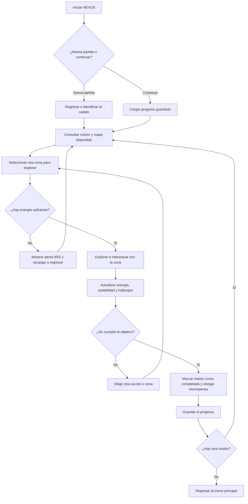

[diseno-del-juego.md](https://github.com/user-attachments/files/34586699/diseno-del-juego.md)
# NEXUS — Diseño del videojuego

**Estudiante:** Jubal Abner Serrano Nina  
**Proyecto:** NEXUS  
**Versión de partida:** H3, aplicación de consola en C#  
**Documento:** Propuesta de experiencia de usuario para la evolución gráfica

---

## 1. Visión del juego

NEXUS es un videojuego de exploración de realidades ambientado en el año 2297. El jugador toma el papel de un cadete explorador que recibe misiones para investigar anomalías en dimensiones desconocidas. Durante cada misión debe decidir qué zonas explorar, administrar su energía, vigilar la estabilidad de la realidad y cumplir objetivos antes de regresar a una zona segura.

La intención es conservar la idea central del NEXUS desarrollado en H3 y evolucionarla gradualmente. La versión inicial funciona mediante una consola y presenta la lógica del juego mediante texto. La propuesta futura trasladará esas acciones a ventanas de Windows Forms, con botones, paneles de estado, mapas y una pantalla de misiones. SQL Server se utilizará para guardar el progreso cuando esa parte sea implementada.

La experiencia debe motivar al jugador mediante tres elementos:

- **Descubrimiento:** explorar nuevas zonas y conocer qué anomalías esconden.
- **Decisiones:** elegir cuándo avanzar, cuándo conservar energía y cuándo volver para evitar perder progreso.
- **Progreso:** completar misiones, registrar realidades exploradas y desbloquear nuevos objetivos.

IRIS funcionará como sistema de apoyo dentro del juego: presentará alertas y mensajes cuando ocurra una situación importante, como energía insuficiente, un riesgo de estabilidad o una misión completada.

**Relación con H3:** el archivo enviado contiene la solución `ConsoleApp1.slnx`, el proyecto `ConsoleApp1.csproj` y el archivo principal `Program.cs`. La propuesta parte de esa aplicación de consola y de las acciones centrales trabajadas durante el desarrollo, como el registro o identificación del cadete, el acceso, el análisis de anomalías, la exploración, la administración de energía y estabilidad, la recarga y los avisos de IRIS. La interfaz gráfica será una nueva forma de utilizar esas mecánicas, no un videojuego separado. La lista exacta de funciones implementadas se documentará y verificará por separado en `arquitectura-actual.md`.

**Estado de las funciones:** Windows Forms, la base de datos SQL Server, el guardado de partidas y las pantallas descritas aquí son parte de la evolución propuesta. No se presentan como funciones ya implementadas en la versión de consola.

## 2. Ciclo principal de juego

Una partida se organizará en el siguiente ciclo. El jugador podrá repetirlo para completar diferentes misiones.



### Secuencia resumida

1. El jugador abre el juego y crea una partida o continúa una existente.
2. Revisa la misión activa, el estado del cadete y las zonas disponibles.
3. Elige una zona y confirma la exploración.
4. El juego comprueba si existe energía suficiente antes de ejecutar la acción.
5. La exploración actualiza los recursos y el estado de la zona; IRIS comunica cualquier resultado relevante.
6. El jugador reúne hallazgos y cumple las condiciones de la misión.
7. Al completar el objetivo, recibe una confirmación y la recompensa correspondiente.
8. La partida guarda el progreso y permite empezar otra misión o regresar al menú.

Si el jugador no tiene suficiente energía, la acción no debe ejecutarse ni consumir recursos. La interfaz debe explicar el motivo y mostrar una opción válida, por ejemplo, volver o recargar si esa función está disponible.

## 3. Mecánicas y reglas

Esta sección distingue las mecánicas que se conservan del concepto de H3 de las reglas que se proponen para la futura versión gráfica.

### 3.1 Explorador o cadete

El jugador controla a un cadete. Su perfil mostrará, como mínimo, su nombre o identificación, energía actual, estabilidad de la realidad y misión activa. La interfaz debe mantener estos datos visibles durante la exploración para que el usuario no tenga que abandonar el mapa para consultar su estado.

En la primera versión gráfica se priorizará un único perfil de cadete. Diferentes clases de personajes, habilidades especiales o personalización avanzada podrán evaluarse posteriormente, pero no son necesarias para demostrar el funcionamiento principal.

### 3.2 Mapas y realidades

Cada realidad representa una zona de exploración. En la pantalla del mapa se distinguirán los siguientes estados:

- **Disponible:** el jugador puede seleccionarla.
- **En exploración:** es la zona que se está investigando actualmente.
- **Explorada:** ya fue completada y debe mostrarse como tal.
- **Bloqueada:** todavía no cumple los requisitos para entrar.

El mapa inicial podrá representarse con zonas y conexiones sencillas en dos dimensiones. No se requiere un mapa 3D. Las nuevas zonas se habilitarán por progreso de la misión, no solamente por hacer clic sobre ellas.

### 3.3 Energía y estabilidad

La energía representa el recurso que permite ejecutar exploraciones. Cada acción podrá tener un costo definido por la regla del juego. Antes de ejecutarla, NEXUS comprobará si la energía disponible cubre el costo. Si no alcanza, la operación se rechaza y la energía permanece igual.

La estabilidad representa el estado de seguridad de la realidad. Las acciones arriesgadas pueden reducirla o activar alertas. Para que el jugador entienda las consecuencias, la interfaz mostrará su valor y utilizará mensajes claros cuando cambie. Los valores y efectos definitivos deberán conservar las reglas del código vigente o documentarse como cambios futuros antes de implementarlos.

La recarga debe ser una acción explícita y mostrar cuánta energía se recuperó. No se debe cambiar un valor silenciosamente. Cuando la energía o estabilidad llegue a un límite crítico, IRIS presentará una advertencia visible y explicará qué acciones siguen disponibles.

### 3.4 Misiones

Cada misión tendrá un nombre, una descripción, un objetivo, un estado y una recompensa prevista. Los estados propuestos son **Pendiente**, **En progreso** y **Completada**. La pantalla de misiones debe indicar qué falta para completar el objetivo, no solo mostrar el nombre de la misión.

La misión se marcará como completada únicamente cuando se cumplan sus condiciones. Al lograrlo, el juego mostrará una confirmación y actualizará la progresión. Las recompensas concretas se definirán de acuerdo con las funciones que se implementen en las próximas etapas.

### 3.5 Inventario y objetos

El inventario permitirá consultar los objetos encontrados durante la exploración. En la primera etapa gráfica se propone mostrar el nombre del objeto, una breve descripción y su cantidad o estado. Si un objeto puede utilizarse, el botón **Usar** estará habilitado; si no puede usarse en ese momento, se explicará el motivo.

El inventario completo y los efectos de cada objeto son parte de la evolución del diseño. No se deben presentar como implementados en H3 si no existen en el código actual.

### 3.6 Interacción y retroalimentación

Las acciones se realizarán mediante botones y selecciones en pantalla. Toda acción importante debe generar una respuesta visible: confirmación, cambio de estado, actualización de recursos o mensaje de error. Las alertas de IRIS servirán para comunicar eventos relacionados con energía, estabilidad, descubrimientos y misiones.

## 4. Diseño de pantallas y navegación

Los siguientes wireframes son bocetos iniciales. Representan la distribución de los elementos y no son interfaces funcionales. La implementación se propone para Windows Forms.

### 4.1 Pantalla de menú principal

```text
+------------------------------------------------------------------+
|                              NEXUS                               |
|                  EXPLORATION / REALITY SYSTEM                    |
|------------------------------------------------------------------|
|                                                                  |
|                    [ NUEVA PARTIDA ]                             |
|                    [ CONTINUAR     ]                             |
|                    [ EXPLORADORES  ]                             |
|                    [ CONFIGURACIÓN ]                             |
|                    [ SALIR         ]                             |
|                                                                  |
|  Estado del sistema: listo                         Versión: 1.0  |
+------------------------------------------------------------------+
```

**Elementos visibles:** título, botones principales y estado general del sistema. El botón **Continuar** se habilitará cuando exista una partida guardada. **Nueva partida** llevará al registro o identificación del cadete. **Exploradores** abrirá el perfil y el inventario. **Configuración** mostrará opciones básicas, y **Salir** pedirá confirmación antes de cerrar.

### 4.2 Pantalla de exploración o mapa

```text
+------------------------------------------------------------------+
| NEXUS > EXPLORACIÓN                  Cadete: [Nombre]             |
|------------------------------------------------------------------|
| Energía: 80/100     Estabilidad: 90/100      Misión: Anomalía 01  |
|------------------------------------------------------------------|
|                                                                  |
|   [Zona A: Explorada] ---- [Zona B: Disponible]                  |
|             |                    |                                |
|        [Zona C: Bloqueada] -- [Zona D: Disponible]               |
|                                                                  |
|------------------------------------------------------------------|
| Zona seleccionada: Zona B                                        |
| Descripción: Se detecta una anomalía pendiente de análisis.       |
| Costo estimado: consultar regla de exploración                    |
| [ EXPLORAR ] [ VOLVER ] [ VER MISIÓN ]                            |
|------------------------------------------------------------------|
| IRIS: Selecciona una zona disponible para continuar.             |
+------------------------------------------------------------------+
```

**Elementos visibles:** indicadores de energía y estabilidad, mapa con estados distinguibles, descripción de la zona seleccionada, acciones disponibles y mensajes de IRIS. Al seleccionar una zona se mostrará su descripción antes de explorarla. Si falta energía, el juego avisará y no ejecutará la acción.

### 4.3 Pantalla de misiones

```text
+------------------------------------------------------------------+
| NEXUS > MISIONES                                                  |
|------------------------------------------------------------------|
| MISIÓN             ESTADO          OBJETIVO                        |
| Anomalía 01        En progreso     Analizar la zona seleccionada   |
| Señal desconocida  Pendiente       Localizar el origen de la señal |
|------------------------------------------------------------------|
| Detalle de la misión seleccionada:                                |
| Nombre: Anomalía 01                                                |
| Descripción: Investigar una alteración detectada por IRIS.        |
| Progreso: completar el análisis requerido                         |
| Recompensa: se definirá según las reglas implementadas            |
|                                                                  |
| [ VER EN MAPA ] [ VOLVER A EXPLORACIÓN ] [ VOLVER AL MENÚ ]        |
+------------------------------------------------------------------+
```

**Elementos visibles:** lista de misiones, estado, objetivo, detalle y botones de navegación. La misión activa debe diferenciarse de las pendientes y las completadas. Los objetivos se redactarán con instrucciones concretas.

### 4.4 Pantalla de exploradores e inventario

```text
+------------------------------------------------------------------+
| NEXUS > EXPLORADOR E INVENTARIO                                   |
|------------------------------------------------------------------|
| CADETE: [Nombre del cadete]                                       |
| Energía: 80/100            Estabilidad: 90/100                    |
|------------------------------------------------------------------|
| INVENTARIO                                                        |
| Objeto                Descripción                    Cantidad     |
| Muestra de anomalía   Hallazgo de la Zona B           1            |
| Celda de energía      Recurso para una recarga         1            |
|------------------------------------------------------------------|
| Objeto seleccionado: Celda de energía                              |
| Detalle: recurso consumible, si está implementado.                |
| [ USAR OBJETO ] [ VOLVER AL MAPA ] [ VOLVER AL MENÚ ]              |
+------------------------------------------------------------------+
```

**Elementos visibles:** identificación del cadete, recursos, lista de objetos, descripción y acciones disponibles. El botón **Usar objeto** solo estará activo cuando el objeto exista y pueda utilizarse. Si todavía no hay objetos en una partida, se mostrará el mensaje “Inventario vacío” en lugar de una lista ficticia.

### 4.5 Navegación entre pantallas

- **Menú principal → Nueva partida → Perfil del cadete → Mapa.**
- **Mapa → Ver misión → Misiones → Volver a exploración.**
- **Mapa → Exploradores e inventario → Volver al mapa.**
- **Misión completada → Confirmación → Guardar progreso → Siguiente misión o menú.**

En todas las pantallas de juego debe existir una forma clara de volver a la pantalla anterior o al menú, sin borrar el progreso por accidente.

## 5. Experiencia de usuario

La interfaz debe ser comprensible para una persona que juega por primera vez. Se aplicarán los siguientes criterios:

### Legibilidad

- Utilizar texto de tamaño cómodo para leer y evitar párrafos extensos en pantalla.
- Mantener contraste suficiente entre el texto y el fondo.
- No comunicar estados solamente mediante colores; acompañarlos con palabras e iconos o símbolos.
- Evitar animaciones o efectos que dificulten leer la información importante.

### Jerarquía visual

- Mostrar el nombre de la pantalla en la parte superior.
- Mantener energía, estabilidad y misión activa en una posición consistente durante la exploración.
- Dar mayor importancia al objetivo actual y a la acción principal.
- Separar la información principal de los detalles secundarios.

### Consistencia

- Utilizar los mismos nombres para las mismas acciones en todas las pantallas.
- Mantener el mismo estilo para botones, estados y mensajes.
- Usar los mismos términos para energía, estabilidad, zonas y misiones, tanto en los textos de IRIS como en los menús.

### Facilidad de navegación

- Ofrecer botones claramente identificados, como **Explorar**, **Ver misión**, **Volver al mapa** y **Guardar progreso**.
- Evitar que el jugador tenga que recorrer muchos menús para realizar una acción frecuente.
- Confirmar acciones que puedan causar una pérdida importante de progreso.
- Permitir navegación por teclado cuando sea posible, además del uso del ratón.

### Retroalimentación de las acciones

- Indicar cuando una exploración comienza, termina o es rechazada.
- Actualizar los recursos inmediatamente después de una acción válida.
- Explicar los errores y cómo resolverlos; por ejemplo: “Energía insuficiente: recarga o selecciona otra acción”.
- Informar claramente cuando una misión se completa y cuando el progreso se guarda correctamente.
- Si ocurre un problema al guardar, no mostrar una confirmación falsa: se debe avisar que el progreso no pudo guardarse.

## 6. Alcance y restricciones

### Alcance prioritario

La primera versión gráfica debe concentrarse en un producto pequeño y funcional:

1. Conservar el flujo central y las reglas útiles del NEXUS de consola.
2. Crear un menú principal y una pantalla de exploración en Windows Forms.
3. Mostrar el estado del cadete, la energía, la estabilidad y la misión activa.
4. Permitir seleccionar zonas y ejecutar exploraciones con validación de energía.
5. Mostrar misiones con sus estados y un inventario básico, según las funciones que se vayan implementando.
6. Separar la interfaz gráfica de la lógica del juego para no colocar todas las reglas dentro de los eventos de los botones.
7. Diseñar y probar el guardado y la recuperación de progreso con SQL Server en una etapa posterior de la evolución.
8. Documentar el proyecto y mantener el código fuente en un repositorio público de GitHub.

### Funcionalidades opcionales o para etapas posteriores

- Mapas con animaciones y efectos visuales avanzados.
- Sonidos, música y escenas cinematográficas.
- Gran variedad de personajes con habilidades propias.
- Enemigos con inteligencia artificial avanzada.
- Generación aleatoria compleja de mapas.
- Estadísticas detalladas, logros y personalización estética.
- Juego multijugador o funciones en línea.

Estas funciones no son necesarias para demostrar la primera versión gráfica y solo se evaluarán cuando el núcleo funcione correctamente.

### Restricciones técnicas y de diseño

- El punto de partida es el código C# de H3; no se debe sustituir por un proyecto sin relación con el original.
- La siguiente versión se orientará a una aplicación de escritorio con Windows Forms y SQL Server.
- El diseño no significa que Windows Forms, SQL Server o las pantallas ya estén programadas: son objetivos de evolución.
- La lógica que decide el costo de energía, el resultado de la exploración y el estado de las misiones debe residir en la lógica del juego, no depender únicamente de la interfaz.
- El acceso a SQL Server deberá estar separado de las pantallas y manejar errores de conexión sin cerrar inesperadamente el juego.
- No se deben guardar contraseñas de conexión directamente en archivos públicos del repositorio.
- El progreso debe validarse y guardarse de forma consistente para evitar datos incompletos.
- La interfaz inicial debe ser viable para un proyecto académico individual y ampliarse por etapas.

### Criterio de finalización de la primera etapa gráfica

La primera etapa podrá considerarse demostrable cuando el usuario pueda iniciar el juego, identificar al cadete, consultar el mapa y la misión, explorar una zona con validación de energía, recibir mensajes claros, consultar su inventario y volver al menú sin errores inesperados. La persistencia con SQL Server se probará cuando sea implementada, mediante pruebas de guardar, cerrar, volver a abrir y recuperar el progreso.

---

**Nota final:** este documento define la experiencia propuesta para la evolución de NEXUS. Antes de implementar cada función, se deberá contrastar con el código vigente de H3, mantener las partes que ya funcionan y documentar cualquier regla nueva. La arquitectura, el modelo de datos y las decisiones de tecnología se explicarán con más detalle en los otros documentos de `docs/`.
