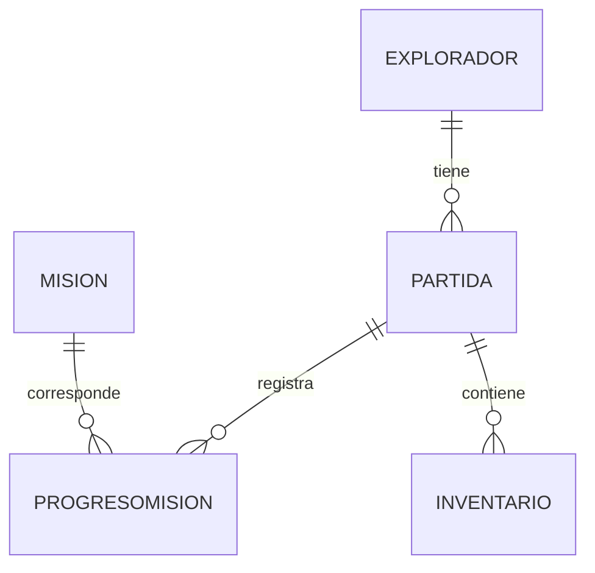

[modelo-de-datos-propuesto.md](https://github.com/user-attachments/files/34564820/modelo-de-datos-propuesto.md)
# Modelo de datos propuesto

SQL Server se utilizará en una etapa futura para conservar el progreso. La versión actual de consola no tiene base de datos; por eso, este modelo es una propuesta y todavía no está implementado.

## 1. Tablas principales

| Tabla | Datos principales | Uso |
|---|---|---|
| `Explorador` | `IdExplorador` (PK), `Nombre`, `Energia`, `NivelAcceso`, `RealidadActual` | Datos del jugador. |
| `Partida` | `IdPartida` (PK), `IdExplorador` (FK), `FechaGuardado` | Guarda una partida de un explorador. |
| `Mision` | `IdMision` (PK), `Codigo`, `Descripcion` | Catálogo de misiones. |
| `ProgresoMision` | `IdProgreso` (PK), `IdPartida` (FK), `IdMision` (FK), `Estado` | Guarda el estado de cada misión dentro de una partida. |
| `Inventario` | `IdInventario` (PK), `IdPartida` (FK), `NombreObjeto`, `Cantidad` | Guarda los objetos de una partida. |

PK significa clave primaria y FK significa clave foránea.

## 2. Relaciones

- Un explorador puede tener varias partidas guardadas: `Explorador 1 — N Partida`.
- Una partida puede tener varios registros de progreso de misión: `Partida 1 — N ProgresoMision`.
- Una misión puede aparecer en el progreso de muchas partidas: `Mision 1 — N ProgresoMision`.
- Una partida puede tener varios objetos: `Partida 1 — N Inventario`.

## 3. Guardar y recuperar

Al guardar, el programa registrará los datos del explorador, la fecha, el estado de las misiones y los objetos. Al continuar, buscará la partida seleccionada y recuperará esos datos para mostrarlos en Windows Forms.

Las operaciones relacionadas con una misma partida deberán guardarse juntas para evitar que quede una parte actualizada y otra no. Se usarán parámetros en las consultas y claves foráneas para mantener las relaciones correctas.
Las claves primarias identifican cada fila y las foráneas relacionan los registros.

Este diseño puede reducirse o ampliarse cuando se definan las pantallas finales. No es necesario crear todas las tablas antes de terminar la primera interfaz.
