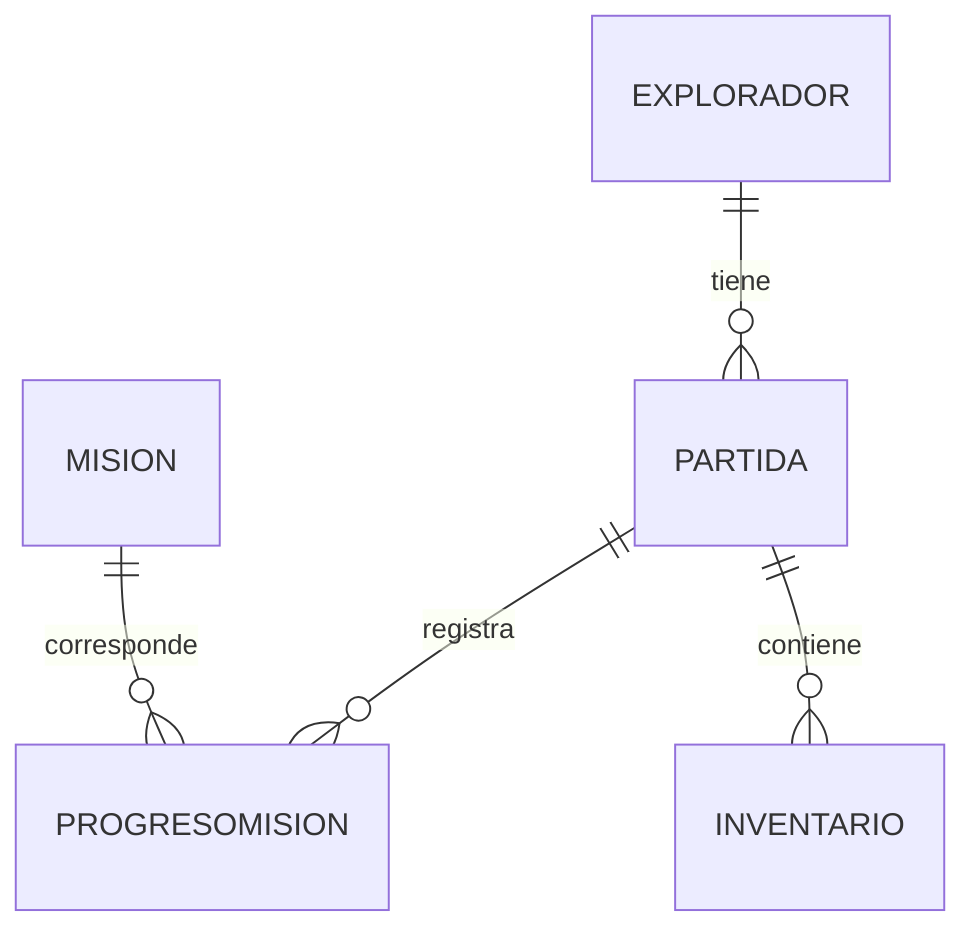

# Modelo de datos de NEXUS

NEXUS dispone de guardado local en JSON y de un repositorio opcional para SQL Server. El esquema real que debe ejecutarse está en `database/01-esquema.sql`.

## 1. Tablas

| Tabla | Campos principales | Uso |
|---|---|---|
| `Explorador` | `IdExplorador` (PK), `Nombre`, `FechaRegistro` | Identifica al cadete. |
| `Partida` | `IdPartida` (PK), `IdExplorador` (FK), `NumeroRanura`, `FechaGuardado`, `Energia`, `Estabilidad`, `NivelAcceso`, `RealidadActual`, `JsonProgreso` | Guarda la ranura y el estado general de la partida. |
| `Mision` | `IdMision` (PK), `Codigo`, `Nombre`, `Descripcion`, `RealidadObjetivo`, `Recompensa` | Catálogo de misiones. |
| `ProgresoMision` | `IdProgreso` (PK), `IdPartida` (FK), `IdMision` (FK), `Estado`, `DatosJson` | Guarda el avance particular de cada misión. |
| `Inventario` | `IdObjeto` (PK), `IdPartida` (FK), `Nombre`, `Descripcion`, `Cantidad` | Guarda los objetos de la partida. |

PK significa clave primaria y FK significa clave foránea.

## 2. Relaciones

- Un explorador puede tener varias partidas: `Explorador 1 — N Partida`.
- Una partida puede contener el progreso de varias misiones: `Partida 1 — N ProgresoMision`.
- Una misión del catálogo puede estar presente en muchas partidas: `Mision 1 — N ProgresoMision`.
- Una partida puede tener varios objetos: `Partida 1 — N Inventario`.

## 3. Guardado y recuperación

La clase `SqlServerRepository` abre una conexión con SQL Server y guarda los datos dentro de una transacción. Las consultas usan parámetros para evitar construir sentencias SQL con texto proporcionado por el usuario. Si ocurre un error, la transacción se revierte.

La partida completa se conserva en `Partida.JsonProgreso` para recuperar su estado exacto, incluyendo energía, estabilidad, realidades, mapas y campaña. Además, el repositorio registra el progreso de cada misión y los objetos en sus tablas correspondientes para permitir consultas posteriores.

## 4. Seguridad y configuración

La cadena de conexión se obtiene de la variable de entorno `NEXUS_SQLSERVER_CONNECTION`. No se incluye usuario, contraseña ni cadena privada en el repositorio.

Para crear la base de datos y configurarla, sigue [database/README.md](../database/README.md). SQL Server es opcional: cuando no está configurado, el juego utiliza las tres ranuras JSON locales.
